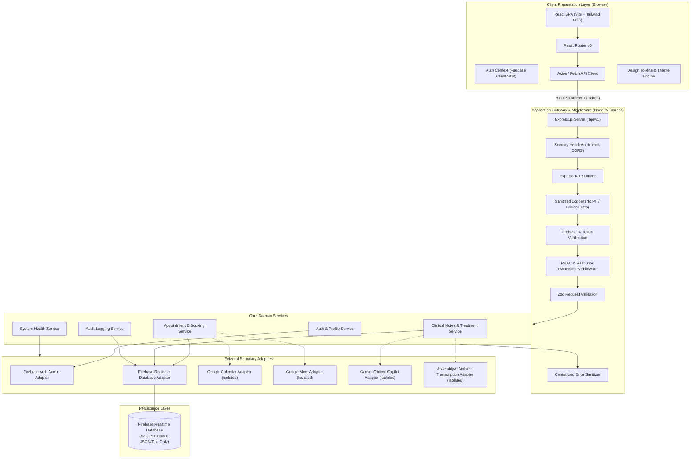

# Psyco AI — System Architecture

**Version:** 1.0.0 (Phase 0 Foundation)  
**Status:** Architectural Baseline  

---

## 1. High-Level Architectural Diagram



---

## 2. Architectural Boundaries and Core Principles

### 2.1 Decoupled Frontend and Backend
* The **Frontend** is a single-page React application bundled using Vite. It handles client-side rendering, user input capture, visual state management, accessibility compliance, and optimistic UX updates.
* The **Backend** is an Express.js REST API exposing a versioned interface (`/api/v1`). It holds sole authority over data persistence, business logic execution, role-based access control, resource ownership checks, and integration with third-party service providers.
* **Frontend is never trusted for authorization.** Every write and sensitive read operation is enforced server-side.

### 2.2 Strict Text-Only Storage Paradigm
* **Persistent Storage Technology:** Firebase Realtime Database is the **exclusive** database.
* **Zero Binary Storage Policy:**
  - Firebase Cloud Storage is explicitly excluded from the stack.
  - No raw audio files (`.wav`, `.mp3`), video files (`.mp4`), or image uploads are stored permanently in the database.
  - No base64-encoded binary media is injected into JSON records.
  - Future audio recordings for clinical transcription are streamed transiently into memory or short-lived buffers, processed into text via AssemblyAI, and wiped immediately upon completion.
  - Authoritative clinical reports and treatment plans are stored strictly as structured JSON schemas.

### 2.3 Boundary Adapters for External Services
* All external services (Google Calendar, Google Meet, Gemini, AssemblyAI) are accessed via dedicated adapter classes.
* Every adapter implements an `isConfigured()` check that safely detects whether requisite credentials and API keys are present.
* If a service is unconfigured, the adapter gracefully falls back to explicit structured notifications (`{ configured: false, status: "UNCONFIGURED" }`) without throwing unhandled exceptions or simulating artificial operational success.

---

## 3. Layer Breakdown

### 3.1 Presentation Layer (Frontend)
* **Framework:** React 18+ with Vite for ultra-fast HMR and production bundling.
* **Routing:** `react-router-dom` with structured route definitions:
  - Public marketing routes (`/`, `/about`, `/services`, `/faq`, `/contact`, `/privacy`, `/terms`).
  - Authentication routes (`/login`, `/register`, `/forgot-password`).
  - Protected patient portal (`/patient/dashboard`, `/patient/appointments`, `/patient/intake`, `/patient/records`).
  - Protected psychologist portal (`/psychologist/dashboard`, `/psychologist/schedule`, `/psychologist/patients`, `/psychologist/sessions`, `/psychologist/notes`).
  - Protected administrator portal (`/admin/dashboard`, `/admin/users`, `/admin/verifications`, `/admin/audit-logs`, `/admin/system`).
* **Design System & Styling:** Tailwind CSS utilizing an explicit centralized design token architecture (`tokens.js`), ensuring dark-first contrast, responsive layouts, and WCAG AA accessibility.
* **State & Authentication:** React Context API (`AuthContext`, `ThemeContext`) paired with a robust Axios-based API client featuring automated token attachment and error interception.

### 3.2 Application Gateway & API Layer (Backend)
* **Framework:** Node.js + Express.js.
* **Middleware Chain:**
  1. `helmet`: Sets secure HTTP response headers (CSP, HSTS, X-Frame-Options).
  2. `cors`: Configurable origin whitelisting matching frontend URL.
  3. `rateLimiter`: IP and user-based throttling on sensitive endpoints.
  4. `sanitizedLogger`: Custom request logger stripping passwords, tokens, and clinical notes from stdout/files.
  5. `authGuard`: Verifies Firebase ID Tokens via the Firebase Admin SDK.
  6. `rbac`: Validates requested role against verified token claims and DB role assignments.
  7. `resourceGuard`: Confirms clinician-patient assignment before granting access to sensitive clinical nodes.
  8. `validateRequest`: Zod schema validation ensuring payloads adhere to expected schemas.
  9. `errorHandler`: Normalizes errors into standard envelope format while keeping internal stack traces hidden in production.

### 3.3 Persistence Layer (Firebase Realtime Database)
* High-availability, low-latency hierarchical JSON database.
* Data access handled via Node.js Firebase Admin SDK with fine-grained security rules.
* Atomic multi-path updates used for transactional operations (e.g., booking an appointment while updating psychologist availability).

---

## 4. Standard API Envelope

All REST endpoints adhere to a unified JSON response schema:

```json
{
  "success": true,
  "data": { ... },
  "error": null,
  "meta": {
    "timestamp": "2026-10-22T03:15:00.000Z",
    "requestId": "req_c92b8d4f",
    "version": "v1"
  }
}
```

In the event of an error:

```json
{
  "success": false,
  "data": null,
  "error": {
    "code": "RESOURCE_FORBIDDEN",
    "message": "You are not authorized to view this clinical record.",
    "details": []
  },
  "meta": {
    "timestamp": "2026-10-22T03:15:00.000Z",
    "requestId": "req_c92b8d4f",
    "version": "v1"
  }
}
```
