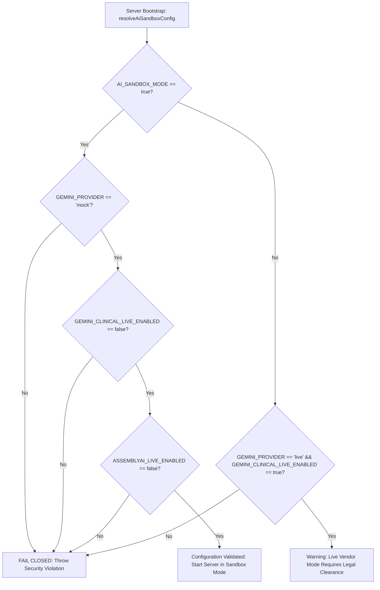

# PHASE 6.3 — AI SANDBOX AND VENDOR PRIVACY SAFEGUARDS IMPLEMENTATION REPORT

**Document ID:** `DOC-P63-SANDBOX-001`  
**Version:** `1.0.0`  
**Classification:** Confidential — Healthcare Privacy, Security Architecture & Compliance Engineering  
**Project:** Psyco AI (Mental Health Practice Management SaaS)  
**Target Environment:** Staging (`https://psyco-ai-staging.web.app` / `https://psyco-ai.onrender.com` / `psyco-ai-staging`)  
**Effective Date:** 31 October 2026  
**Status:** IMPLEMENTED & VERIFIED  

---

## 1. Executive Summary

During the Phase 6.2 Vendor Privacy Configuration Audit, Psyco AI conducted a comprehensive technical verification of its third-party AI and ambient speech transcription dependencies:
1. **Google Gemini:** Verified as currently integrating via `@google/genai` (v2.30.0) targeting the Google AI Studio Developer API (`generativelanguage.googleapis.com`). Under Google's Developer API Terms of Service, free-tier accounts permit human review and training on user content, and even with an active billing card attached, Google AI Studio does **NOT** provide a Business Associate Agreement (BAA), does not offer Zero Data Retention guarantees, and explicitly restricts clinical and healthcare-regulated workloads.
2. **AssemblyAI:** Verified as utilizing the ephemeral token endpoint (`https://streaming.assemblyai.com/v3/token`) for ambient session transcription. Model-training opt-out and zero-retention policies are enforced at the account contract level and cannot be cryptographically proven via client-facing tokens alone.

To ensure strict compliance with healthcare confidentiality (DISHA guidelines, DPDP Act 2023, HIPAA Privacy Rule, and clinical ethics), **Phase 6.3 implements an uncompromising, fail-closed AI Sandbox and Vendor Privacy Safeguard Architecture**.

All external Google Gemini and AssemblyAI network transmissions are severed in clinical workflows. All AI-generated clinical documentation in staging is generated by a deterministic, synthetic mock engine (`mockAiAdapter`). Every output is immutably tagged as synthetic and draft-only, and psychologist review and digital signature remain strictly enforced.

---

## 2. Threat Model & Vendor Privacy Vulnerabilities

| Threat ID | Threat Vector | Uncontrolled Risk | Phase 6.3 Safeguard / Control |
| :--- | :--- | :--- | :--- |
| **THREAT-01** | Google AI Studio Prompt Ingestion | Prompt contains psychotherapy dialogue, symptoms, or therapist formulations; Google logs data for model training/human review. | Outbound calls to Google Gemini are blocked at the integration adapter level. External Gemini SDK client is never invoked. |
| **THREAT-02** | Google Billing Assumption Fallacy | Developers assume active credit card / Pay-As-You-Go status resolves developer API privacy limitations. | Explicit architectural policy: Active billing in AI Studio does NOT confer HIPAA BAA or clinical data processing rights. Live mode disabled by default. |
| **THREAT-03** | AssemblyAI Account Opt-Out Blindspot | Client streams real microphone audio to AssemblyAI before legal verification of enterprise zero-retention contract. | Live WebSocket token issuance blocked. Synthetic mock tokens issued; testers receive visual warning; real audio blocked. |
| **THREAT-04** | Client-Side Feature Flag Tampering | Client modifies local state or localStorage to enable live AI endpoints. | **Server-side enforcement only**: Flags evaluated at backend startup (`config.aiSandbox`). Requests validated server-side. |
| **THREAT-05** | Autonomous Clinical Diagnosis | AI draft auto-finalizes into official medical chart without clinician review. | All drafts stored with `isDraft: true`, `approvalStatus: 'pending_approval'`. Approval endpoint strictly enforces psychologist role and digital signature. |
| **THREAT-06** | Admin Clinical Data Breach | Administrative accounts access confidential psychotherapy drafts or transcripts. | Strict ReBAC enforcement: All AI and transcription endpoints return `HTTP 403 Forbidden` (`ADMIN_CLINICAL_ACCESS_PROHIBITED`) to admins. |
| **THREAT-07** | Audio Buffer Persistence Leak | Temporary audio recordings or raw PCM buffers stored in database or disk. | Zero Binary Persistence Invariant: Psyco AI maintains pure text/JSON schema. No audio files or binary blobs are written to disk or Firebase RTDB. |

---

## 3. Server-Side Feature Flag Architecture & Fail-Closed Startup

Configuration is governed by `backend/src/config/aiSandboxConfig.js` and loaded at server initialization in `backend/src/config/index.js`.

### 3.1 Server Environment Flags

```ini
# Phase 6.3 AI Sandbox & Vendor Privacy Safeguards
GEMINI_PROVIDER=mock
GEMINI_CLINICAL_LIVE_ENABLED=false
ASSEMBLYAI_LIVE_ENABLED=false
AI_SANDBOX_MODE=true
```

### 3.2 Configuration Matrix & Fail-Closed Enforcement Rules

The configuration validator `validateAiSandboxConfig()` executes during application bootstrap. If any inconsistency or hazardous permutation is detected, the server immediately throws an unhandled exception and refuses to bind the network port:



#### Permitted vs Prohibited Configurations:

| Configuration Permutation | Permitted? | Result |
| :--- | :--- | :--- |
| `AI_SANDBOX_MODE=true`<br>`GEMINI_PROVIDER=mock`<br>`GEMINI_CLINICAL_LIVE_ENABLED=false`<br>`ASSEMBLYAI_LIVE_ENABLED=false` | **YES** | Safe internal pilot sandbox. 100% deterministic mock generation. Zero external calls. |
| `AI_SANDBOX_MODE=true`<br>`GEMINI_PROVIDER=live` | **NO** | `[FAIL-CLOSED SECURITY VIOLATION] GEMINI_PROVIDER must be 'mock' when AI_SANDBOX_MODE is true.` |
| `AI_SANDBOX_MODE=true`<br>`GEMINI_CLINICAL_LIVE_ENABLED=true` | **NO** | `[FAIL-CLOSED SECURITY VIOLATION] GEMINI_CLINICAL_LIVE_ENABLED must be false when AI_SANDBOX_MODE is true.` |
| `AI_SANDBOX_MODE=true`<br>`ASSEMBLYAI_LIVE_ENABLED=true` | **NO** | `[FAIL-CLOSED SECURITY VIOLATION] ASSEMBLYAI_LIVE_ENABLED must be false when AI_SANDBOX_MODE is true.` |
| `GEMINI_PROVIDER=mock`<br>`GEMINI_CLINICAL_LIVE_ENABLED=true` | **NO** | `[FAIL-CLOSED CONFIG ERROR] Inconsistent configuration: GEMINI_CLINICAL_LIVE_ENABLED cannot be true when GEMINI_PROVIDER is mock.` |

---

## 4. Deterministic Mock AI Provider (`mockAiAdapter.js`)

The `mockAiAdapter` provides high-fidelity, deterministic synthetic clinical documentation across all 8 supported Psyco AI documentation schemas without invoking Google Gemini or transmitting patient records:

1. `GENERATE_SOAP`: Structured Subjective, Objective, Assessment, Plan with turn-level evidence grounding.
2. `GENERATE_DAP`: Data, Assessment, Plan documentation format.
3. `GENERATE_BIRP`: Behavior, Intervention, Response, Plan format.
4. `GENERATE_SESSION_SUMMARY`: Clinical session summary, risk notes, and presenting concerns.
5. `GENERATE_TREATMENT_PLAN_DRAFT`: Measurable short-term objectives, therapeutic modalities, and review intervals.
6. `GENERATE_HOMEWORK_SUGGESTIONS`: Between-session cognitive/behavioral exercises with clinical rationale.
7. `GENERATE_FOLLOW_UP_SUGGESTIONS`: Care continuity tasks, scheduling, and standardized inventory milestones.
8. `CHECK_DOCUMENTATION_COMPLETENESS`: Documentation domain completeness evaluation and gap identification.

### Synthetic Provenance Invariants:
Every generated output from `mockAiAdapter` is tagged with:
```json
{
  "modelUsed": "mock-deterministic-clinical-v1",
  "isSimulated": true,
  "isSynthetic": true,
  "isMock": true,
  "provider": "mock",
  "sandboxMode": true
}
```
All clinical text fields are explicitly prefixed with `[SYNTHETIC TEST DRAFT]` or `[SYNTHETIC]` to eliminate clinician confusion.

---

## 5. Gemini Adapter Sandbox Delegation

In `backend/src/integrations/gemini/geminiAdapter.js`, the core entrypoint `generateClinicalDocumentation()` evaluates the sandbox configuration before touching the Google GenAI SDK:

```javascript
const isSandbox = Boolean(config.aiSandbox?.sandboxMode);
const isMock = config.aiSandbox?.geminiProvider === 'mock';
const liveEnabled = Boolean(config.aiSandbox?.geminiClinicalLiveEnabled);

if (isSandbox || isMock || !liveEnabled) {
  logger.info(
    `[AI SANDBOX GUARD] External Gemini call blocked for ${jobType}. Routing to deterministic mockAiAdapter. (sandboxMode=${isSandbox}, provider=${config.aiSandbox?.geminiProvider})`
  );
  return mockAiAdapter.generateClinicalDocumentation(jobType, context);
}
```

The adapter status endpoint (`/api/v1/ai/status`) advertises:
```json
{
  "service": "Google Gemini Clinical Copilot",
  "configured": true,
  "status": "SANDBOX_MOCK_ACTIVE",
  "providerMode": "mock",
  "sandboxMode": true,
  "clinicalLiveEnabled": false,
  "externalCallsBlocked": true,
  "model": "mock-deterministic-clinical-v1",
  "storagePolicy": "ZERO_EXTERNAL_TRANSMISSION",
  "humanInTheLoopEnforced": true,
  "message": "External Gemini calls disabled in clinical workflows. Deterministic mock provider active for pilot sandbox."
}
```

---

## 6. AssemblyAI Streaming Sandbox Controls

Until enterprise model-training opt-out and zero-retention documentation are executed:
1. `assemblyaiAdapter.createStreamingToken()` intercepts token requests. If `AI_SANDBOX_MODE=true` or `ASSEMBLYAI_LIVE_ENABLED=false`, the adapter returns a synthetic sandbox token (`sandbox_mock_token_<hex>`) and a simulated WebSocket URL without contacting `https://streaming.assemblyai.com/v3/token`.
2. Testers are notified via an explicit banner in `LiveTranscriptionWidget.jsx`:
   > **AI Sandbox Mode (Staging Pilot):** Real clinical audio processing to AssemblyAI is blocked pending model-training opt-out verification. Synthetic test audio only is permitted in this designated sandbox. Zero raw audio persistence enforced.
3. The WebSocket streamer (`AudioStreamer`) immediately wipes PCM audio buffers from browser memory after WebSocket frame dispatch.
4. No binary audio files are ever written to disk or Firebase Realtime Database.

---

## 7. Audit Logging Schema (Zero Content Leakage)

All AI job lifecycle events (`AI_JOB_CREATED`, `AI_JOB_COMPLETED`, `AI_JOB_FAILED`, `AI_DRAFT_APPROVED`) and transcription token events (`TRANSCRIPTION_TOKEN_ISSUED`) are recorded in `/auditLogs` with strict privacy sanitization:

### Audit Event Data Contract:
- **Recorded:** Provider mode (`mock`), Sandbox indicator (`true`), Synthetic indicator (`true`), Request timestamp, Operation result (`queued` | `success` | `failed` | `approved`), Actor user ID, Actor role.
- **Strictly Prohibited:** Raw transcript text, full clinical draft content, patient identifying information, authorization tokens, API keys, private system prompts.

```json
{
  "action": "AI_JOB_COMPLETED",
  "actorRole": "psychologist",
  "actorUserId": "psych_sandbox_01",
  "id": "aud_1793460431389_abc12",
  "ipAddress": "127.0.0.1",
  "metadata": {
    "attemptCount": 1,
    "draftId": "aid_1793460431388_fa219c63",
    "isSynthetic": true,
    "jobType": "GENERATE_SOAP",
    "modelUsed": "mock-deterministic-clinical-v1",
    "providerMode": "mock",
    "sandboxMode": true,
    "status": "success"
  },
  "targetResource": "job_1793460431379_8eaa4d06",
  "timestamp": "2026-10-31T15:27:11.389Z"
}
```

---

## 8. Enterprise Provider Alternatives Investigation

While external Gemini calls remain suspended in clinical workflows, the engineering team evaluated viable enterprise-grade alternatives for future migration:

| Dimension | Google AI Studio (Current, Suspended) | Google Cloud Vertex AI (Gemini Enterprise) | Azure OpenAI Service | AWS Bedrock |
| :--- | :--- | :--- | :--- | :--- |
| **HIPAA BAA Available** | **NO** | **YES** (via GCP HIPAA BAA) | **YES** (via Microsoft BAA) | **YES** (via AWS BAA) |
| **Zero Data Retention** | No (Free: 18 mo retention; Pay-As-You-Go: still lacks BAA) | **YES** (Data is not logged, not shared, not used to train models) | **YES** (With approved Zero Data Retention exemption) | **YES** (Stateless invocation, no model training) |
| **Indian Data Residency** | No (Global endpoints) | **YES** (`asia-south1` Mumbai / `asia-south2` Delhi) | **YES** (Central India / South India) | **YES** (`ap-south-1` Mumbai) |
| **DISHA / DPDP Act Alignment** | Non-compliant | **Compliant** with appropriate enterprise agreement | **Compliant** with enterprise agreement | **Compliant** with enterprise agreement |
| **Migration Effort** | Baseline | **LOW** (Compatible SDK & Gemini prompt architecture) | **MEDIUM** (Format & prompt adaptation to GPT-4o) | **MEDIUM** (Adaptation to Claude 3.5 Sonnet) |
| **Recommendation** | **SUSPENDED** | **RECOMMENDED PRIMARY ENTERPRISE TARGET** | Secondary Fallback | Secondary Fallback |

---

## 9. Conclusion

Phase 6.3 establishes an ironclad, verifiable safeguard layer around Psyco AI's clinical documentation and ambient transcription workflows. Real patient data is prevented from reaching unverified external APIs, while psychologists and staging testers retain full end-to-end functionality utilizing deterministic synthetic drafts.
