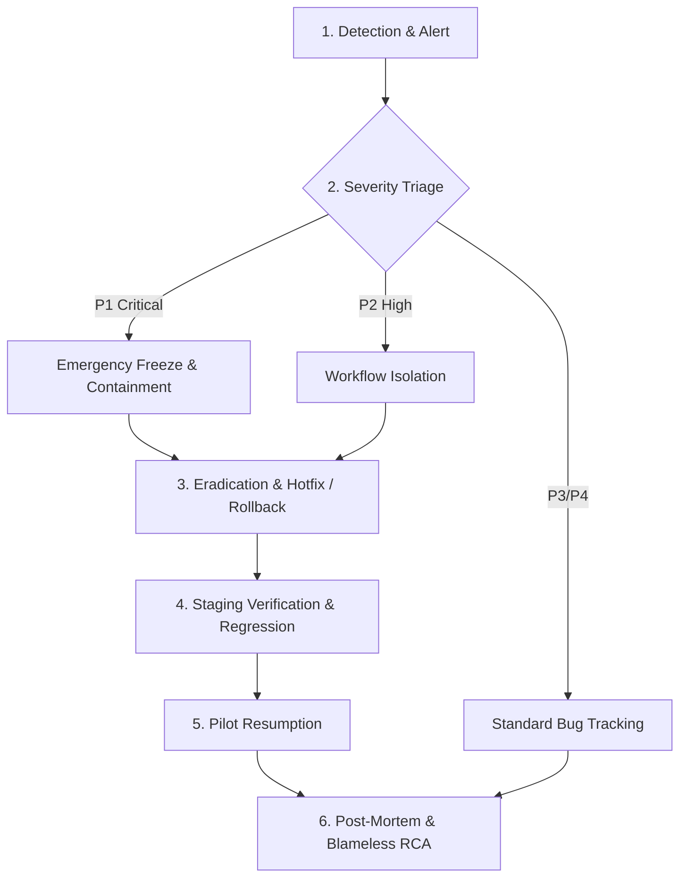

# Phase 6: Operational Incident Response Guide & Disaster Recovery Runbook

**Document Identifier:** `PSYCO-DOC-P6-004`  
**Version:** `1.0.0`  
**Environment:** Staging (`psyco-ai-staging.web.app` / `psyco-ai.onrender.com`)  
**Firebase Project:** `psyco-ai-staging`  
**Production Isolation Safeguard:** `psyco-9c13d` strictly isolated and prohibited  
**Date:** October 31, 2026  
**Status:** Approved for Controlled Pilot Operations  

---

## 1. Purpose & Scope

This operational runbook establishes the protocols, escalation paths, containment measures, and disaster recovery procedures for the **Psyco AI Controlled Pilot**. 

Because Psyco AI processes sensitive mental health workflow information, this guide enforces strict **patient data isolation**, **administrative clinical lockout**, **Human-in-the-Loop (HITL) clinical safety overrides**, and **zero-downtime containment** protocols.

> [!CRITICAL]
> **Production Protection Invariant:** All procedures in this runbook apply **exclusively to the Staging Environment (`psyco-ai-staging`)**. Under no circumstances should any command, script, or restore procedure target the production Firebase project `psyco-9c13d`.

---

## 2. Incident Severity Classification Matrix

| Severity Level | Definition | Pilot Impact | Response SLA | Resolution SLA | Examples |
| :--- | :--- | :--- | :--- | :--- | :--- |
| **P1 — Critical** | Immediate threat to patient privacy, clinical safety hazard, total service outage, or cryptographic credential leak. | Immediate Pilot Halt | < 15 minutes | < 2 hours | - Admin accessing clinical records (breach of lockout).<br>- Token bypass exposing patient data.<br>- AI copilot prescribing or independently publishing unverified notes.<br>- Backend service completely down during pilot testing. |
| **P2 — High** | Core clinical or scheduling workflow failure with no immediate privacy compromise. | Workflow Suspended | < 30 minutes | < 6 hours | - Booking conflict engine allowing overlapping appointments.<br>- AI note generation crashing or timing out.<br>- Audit logging service failure (`/audit` write rejection).<br>- Psychologist verification state desynchronization. |
| **P3 — Medium** | Non-blocking functional defect or degraded performance in auxiliary features. | Pilot Continues with Workaround | < 2 hours | < 24 hours | - FAQ keyword search rendering unexpected results.<br>- Notification badge delay.<br>- Form validation message ambiguity.<br>- Minor styling or responsive layout defects. |
| **P4 — Low** | Cosmetic defect, minor documentation discrepancy, or non-urgent suggestion. | Pilot Continues | < 8 hours | Next Sprint | - Typo in FAQ copy.<br>- Tooltip clipping on small mobile viewports.<br>- Non-blocking analytics telemetry latency. |

---

## 3. Incident Response Team & Escalation Hierarchy

```
+-----------------------------------------------------------+
|               INCIDENT COMMANDER (IC)                     |
|  - Owns triage, pilot pause/resume, and final RCA         |
+-----------------------------+-----------------------------+
                              |
         +--------------------+--------------------+
         |                                         |
+--------v------------------+             +--------v------------------+
|    TECHNICAL LEAD (TL)    |             |  CLINICAL SAFETY OFFICER  |
| - Backend/Frontend/DB Ops |             | - Evaluates AI output     |
| - Log analysis & rollbacks|             | - Clinical note integrity |
+--------+------------------+             +---------------------------+
         |
+--------v------------------+
|   COMMUNICATIONS LEAD     |
| - Participant alerts      |
| - Incident bulletin log   |
+---------------------------+
```

### Roles & Responsibilities

1. **Incident Commander (IC):**
   - Declares incident severity level.
   - Makes the operational decision to **Pause Pilot** if P1 occurs.
   - Authorizes any staging rollbacks or database restoration actions.
2. **Technical Lead (TL):**
   - Investigates Render runtime logs and Firebase RTDB state.
   - Implements containment (e.g., user account suspension, token revocation).
   - Coordinates deployment rollback or hotfix validation.
3. **Clinical Safety Officer (CSO):**
   - Assesses any report of erroneous AI-generated clinical suggestions.
   - Ensures no patient or synthetic client suffered record corruption.
   - Verifies the integrity of versioned amendments and digital signatures.
4. **Communications Lead (CL):**
   - Issues status broadcasts to participating psychologists and administrators.
   - Logs entries in the `docs/phase6/PHASE_6_KNOWN_ISSUES_REGISTER.md`.

---

## 4. Phase-by-Phase Incident Lifecycle



### Phase 1: Detection & Alerting
- **Sources:**
  - Automated monitoring: Backend HTTP 5xx spikes on Render dashboard.
  - Client error catches: Unhandled React boundary errors reported via staging console.
  - Participant reports: Pilot psychologists or admins submitting urgent tickets via the Support Portal.
  - Audit anomalies: Daily review of `/auditLogs` for unexpected HTTP 403 spikes or unauthorized route attempts.

### Phase 2: Containment Protocols

#### Scenario A: Unauthorized Access / Compromised Test Account
If a pilot account is suspected of credential compromise or role escalation:
1. **Immediate Revocation via Admin Portal:**
   - Admin navigates to `/admin/users`.
   - Selects the compromised user and clicks **Suspend User**.
   - Invokes backend: `PUT /api/v1/admin/users/:userId/suspend`.
   - Result: User record marked `status: 'suspended'`; subsequent API requests immediately rejected with `403 User account is suspended`.
2. **Firebase Auth Revocation:**
   - In Firebase Admin Console (`psyco-ai-staging`), revoke refresh tokens for the UID.

#### Scenario B: Administrative Clinical Privacy Violation Alert
If an administrator claims or attempts to view clinical records:
1. Verify that backend middleware `requireClinicalRole` blocked the request with `403 Forbidden` (`ADMIN_CLINICAL_ACCESS_PROHIBITED`).
2. If frontend accidentally exposed clinical UI elements (intake notes, transcripts, SOAP drafts):
   - Immediately issue a staging frontend rollback to restore complete UI lockout.
   - Review `/auditLogs` for all queries executed during the window.

#### Scenario C: Erroneous / Hallucinated AI Copilot Output
If an AI note generation draft contains fabricated clinical claims or contraindications:
1. Advise the psychologist to use the **Edit Note Draft** interface immediately.
2. Psychologists MUST NOT apply their digital signature to incorrect drafts.
3. If systemic hallucination occurs:
   - Disable AI Copilot toggle on staging via backend environment variable `FEATURE_AI_COPILOT=false`.
   - Psychologists seamlessly fall back to manual SOAP note authoring.

---

## 5. Rollback Runbooks

### 5.1 Frontend Rollback Runbook (Firebase Hosting)

If a newly deployed frontend build introduces critical errors or regressions:

1. **Verify Target Environment:**
   Ensure CLI is pointed to `psyco-ai-staging`:
   ```bash
   firebase use psyco-ai-staging
   ```
2. **Review Hosting Release History:**
   ```bash
   firebase hosting:channel:list
   ```
3. **Rollback to Prior Release:**
   - In the Firebase Console -> Hosting (`psyco-ai-staging`), locate the release history table.
   - Identify the previous verified release (corresponding to commit `4e9ff08`).
   - Click the three dots menu (`...`) on the target previous release and select **Rollback**.
   - Rollback takes effect globally within 60 seconds across all CDN edge caches.
4. **Verify Rollback:**
   - Execute HTTP inspection:
     ```bash
     curl -I https://psyco-ai-staging.web.app
     ```
   - Perform a cache-cleared browser verification to confirm asset bundles match the previous release hash.

---

### 5.2 Backend Rollback Runbook (Render Web Service)

If a backend service regression or unhandled crash loop occurs:

1. **Access Render Dashboard:**
   - Navigate to service `psyco-ai` at `https://dashboard.render.com`.
   - Confirm current deployed commit hash.
2. **Trigger Instant Rollback:**
   - Under the **Deploys** tab, locate the prior stable deploy (Commit `4e9ff08`).
   - Click **Rollback to this deploy**.
   - Render initiates an atomic container swap without downtime.
3. **Verify Liveness and Readiness:**
   - Execute health checks:
     ```bash
     curl -s https://psyco-ai.onrender.com/health | jq .
     curl -s https://psyco-ai.onrender.com/ready | jq .
     ```
   - Verify response returns HTTP 200 with status `ok` and `database: connected`.

---

## 6. Disaster Recovery & Database Restoration Runbook

### 6.1 Database Protection Invariant
- **Target Database:** `https://psyco-ai-staging-default-rtdb.firebaseio.com/`
- **Prohibited Database:** `https://psyco-9c13d-default-rtdb.firebaseio.com/` (Production)

### 6.2 Point-in-Time Database Restoration Procedure

In the event of accidental data corruption or catastrophic deletion during the controlled pilot:

#### Step 1: Declare Maintenance Freeze
1. Notify all pilot participants via email and staging announcement banner.
2. Apply maintenance read-only rules temporarily to `psyco-ai-staging` RTDB:
   ```json
   {
     "rules": {
       ".read": "auth != null",
       ".write": false
     }
   }
   ```

#### Step 2: Retrieve Automated Staging Backup
1. Access Google Cloud Platform / Firebase Console for project `psyco-ai-staging`.
2. Navigate to **Realtime Database -> Backups**.
3. Select the latest automated snapshot created prior to the corruption timestamp.
4. Download the compressed backup JSON file (`psyco-ai-staging-backup-YYYY-MM-DD-HHMM.json.gz`).

#### Step 3: Validate Backup Integrity Locally
1. Decompress and inspect the backup snapshot locally:
   - Check file size.
   - Verify root keys: `"users"`, `"psychologists"`, `"clinics"`, `"appointments"`, `"auditLogs"`.
   - Verify that all clinical data contains text/JSON only (confirm absence of base64 images or binary payloads).

#### Step 4: Restore Backup to Staging RTDB
1. In Firebase Console for `psyco-ai-staging`:
   - Click **Realtime Database -> Import JSON**.
   - Select the validated backup file.
   - Confirm import overwrite.
2. Alternatively, via Firebase CLI:
   ```bash
   firebase database:set / path/to/validated_staging_backup.json --project psyco-ai-staging --confirm
   ```

#### Step 5: Re-Apply Production-Grade RTDB Security Rules
1. Re-deploy the verified security rules from `database.rules.json`:
   ```bash
   firebase deploy --only database --project psyco-ai-staging
   ```
2. Verify that administrative clinical lockout rules and audit log write-locks remain strictly enforced.

#### Step 6: Post-Restore Verification
1. Run backend automated regression suite:
   ```bash
   npm test
   ```
2. Execute synthetic health verification for:
   - Patient login.
   - Psychologist appointment listing.
   - Admin user listing.
3. Lift the maintenance freeze and broadcast resumption to pilot participants.

---

## 7. Pilot Exit & Pause Criteria

### Immediate Pilot Pause Triggers (Mandatory Freeze)
The Incident Commander MUST pause the controlled pilot immediately upon any of the following:
1. **Clinical Data Exposure:** Any incident where an administrator or unauthorized therapist views a patient record.
2. **AI Safety Defect:** Any occurrence where an AI draft prescribes pharmaceutical dosage or provides harmful psychological advice without triggering safety warnings.
3. **Data Loss Event:** Corruption of consultation records or digital signatures that cannot be restored within 30 minutes.
4. **Sustained Outage:** Backend or frontend unavailability exceeding 60 minutes during scheduled pilot testing windows.

### Pilot Resumption Criteria
The pilot may ONLY resume when:
1. Root cause is identified and patched on staging.
2. All 218 automated backend regression tests pass.
3. Verification is signed off by the Technical Lead and Clinical Safety Officer.
4. An incident report is filed in `docs/phase6/PHASE_6_KNOWN_ISSUES_REGISTER.md`.

---

## 8. Post-Incident Review (PIR) Protocol

Within 24 hours of resolving any P1 or P2 incident:
1. The Incident Commander convenes a **Blameless Retrospective**.
2. A formal **Post-Incident Review (PIR)** is created covering:
   - Incident Timeline (Discovery, Response, Containment, Recovery).
   - Root Cause Analysis (5 Whys methodology).
   - What went well during containment.
   - Where detection or recovery was delayed.
   - Action items with assigned owners and deadlines.
3. Update `docs/phase6/PHASE_6_KNOWN_ISSUES_REGISTER.md` to reflect any newly discovered failure modes.
