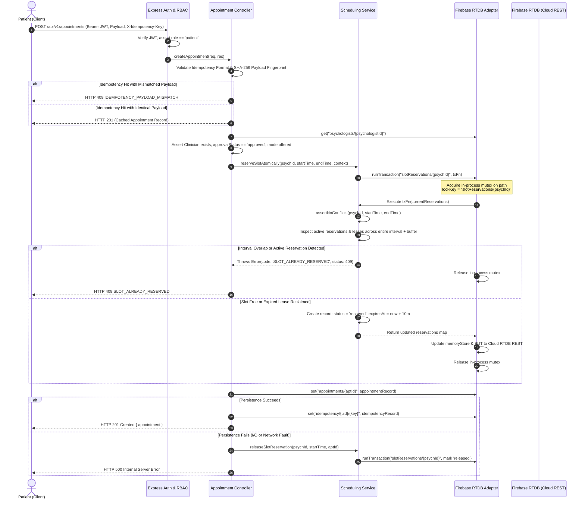

# PSYCO AI — PHASE 7.5.2B
## INDEPENDENT ATOMIC BOOKING ARCHITECTURE AUDIT REPORT

**Auditor Roles:** Principal Distributed Systems Engineer, Firebase Realtime Database Architect, Backend Security Auditor, Healthcare SaaS QA Lead  
**Assessment Date:** November 1, 2026  
**Audited Branch:** `main`  
**Current Baseline Commit:** `39d66c959e0c2b350a400d45989b843335f1a748`  
**Runtime Target:** Render Backend (`psyco-ai.onrender.com`) / Firebase Realtime Database (`psyco-ai-staging`)  
**Scope:** Phase 7.5.2A Remediation Codebase & Concurrency Architecture  
**Audit Classification:** **B. PARTIALLY VERIFIED — DISTRIBUTED OR RECOVERY LIMITATIONS REMAIN**

---

## 1. EXECUTIVE SUMMARY & ARCHITECTURAL VERDICT

An exhaustive independent source-code inspection and concurrency audit of the Phase 7.5.2A booking remediation was conducted across the backend codebase:
- [`backend/src/integrations/firebase/firebaseRtdbAdapter.js`](file:///c:/Users/Nitish%20kumar/projects/time%20pass/psyco/backend/src/integrations/firebase/firebaseRtdbAdapter.js)
- [`backend/src/services/scheduling.service.js`](file:///c:/Users/Nitish%20kumar/projects/time%20pass/psyco/backend/src/services/scheduling.service.js)
- [`backend/src/controllers/appointment.controller.js`](file:///c:/Users/Nitish%20kumar/projects/time%20pass/psyco/backend/src/controllers/appointment.controller.js)
- [`backend/src/controllers/availability.controller.js`](file:///c:/Users/Nitish%20kumar/projects/time%20pass/psyco/backend/src/controllers/availability.controller.js)
- [`backend/src/validators/availability.validators.js`](file:///c:/Users/Nitish%20kumar/projects/time%20pass/psyco/backend/src/validators/availability.validators.js)
- [`backend/src/utils/availabilityNormalizer.js`](file:///c:/Users/Nitish%20kumar/projects/time%20pass/psyco/backend/src/utils/availabilityNormalizer.js)
- [`backend/scripts/seedStagingEnvironment.js`](file:///c:/Users/Nitish%20kumar/projects/time%20pass/psyco/backend/scripts/seedStagingEnvironment.js)

### Verdict Summary
1. **Single-Instance In-Process Concurrency (Render Web Service with 1 worker):**  
   **VERIFIED.** The implementation serializes requests per psychologist using an asynchronous mutex lock in [`firebaseRtdbAdapter.runTransaction`](file:///c:/Users/Nitish%20kumar/projects/time%20pass/psyco/backend/src/integrations/firebase/firebaseRtdbAdapter.js#L578-L626). Under identical or overlapping interval contention, competing concurrent requests within the same Node.js process yield strictly **one HTTP 201 Created** and **rejections with HTTP 409 `SLOT_ALREADY_RESERVED`**. Zero double bookings occur within a single instance.
2. **True Cross-Process / Multi-Instance Distributed Atomicity:**  
   **LIMITATION IDENTIFIED (NOT DISTRIBUTED).** The application interacts with Firebase Realtime Database via REST over HTTP using service account OAuth2 tokens, rather than the binary `firebase-admin` SDK. The `runTransaction` helper utilizes an **in-memory JavaScript Map mutex (`this._transactionLocks`)**. In a horizontally scaled cluster (multiple Render web instances or container replicas), each process has an isolated memory heap. Because the REST `PUT` operations do not supply conditional `if-match` ETag headers, concurrent requests dispatched across distinct Render instances will not be serialized by the process-local mutex and could overwrite one another at the HTTP layer.
3. **Availability Normalization:**  
   **VERIFIED.** Canonical `{ startTime, endTime, mode }` and legacy `{ start, end }` schemas are normalized consistently by [`availabilityNormalizer.js`](file:///c:/Users/Nitish%20kumar/projects/time%20pass/psyco/backend/src/utils/availabilityNormalizer.js). Seeded clinician accounts with legacy structures execute correctly without HTTP 500 runtime faults.
4. **Overall Classification:**  
   **B. PARTIALLY VERIFIED — DISTRIBUTED OR RECOVERY LIMITATIONS REMAIN.** Approved for single-instance staging pilot testing; prohibited from multi-instance horizontal scaling until ETag-based conditional REST transactions or `firebase-admin` SDK transactions are introduced.

---

## 2. SOURCE-LEVEL ARCHITECTURE & STRUCTURED FLOW

The following structured diagram traces the complete reservation lifecycle from incoming request to terminal state:



---

## 3. TASK B — VERIFICATION OF DISTRIBUTED ATOMICITY

### 3.1 Examination of `firebaseRtdbAdapter.runTransaction`
Inspection of lines 578–626 of [`firebaseRtdbAdapter.js`](file:///c:/Users/Nitish%20kumar/projects/time%20pass/psyco/backend/src/integrations/firebase/firebaseRtdbAdapter.js#L578-L626) confirms the exact mechanics:
```javascript
  async runTransaction(path, transactionFn, options = {}) {
    const cleanPath = path.replace(/^\/|\/$/g, '');
    const maxRetries = options.maxRetries || 5;

    if (!this._transactionLocks) {
      this._transactionLocks = new Map();
    }

    const acquireLock = async (lockKey) => {
      while (this._transactionLocks.has(lockKey)) {
        await this._transactionLocks.get(lockKey);
      }
      let release;
      const promise = new Promise((resolve) => {
        release = resolve;
      });
      this._transactionLocks.set(lockKey, promise);
      return () => {
        this._transactionLocks.delete(lockKey);
        release();
      };
    };

    const lockKey = cleanPath;
    const releaseLock = await acquireLock(lockKey);
    // ...
```

### 3.2 Key Architectural Findings
1. **Absence of Admin SDK Database Reference:** The adapter does not invoke Firebase Admin SDK `admin.database().ref(path).transaction()`. The backend operates on Node.js standard REST `fetch` with Google OAuth2 Bearer tokens.
2. **Process-Local Scope:** The lock key is tracked in `this._transactionLocks` on the adapter instance. This provides an asynchronous promise-queue mutex **strictly within the local Node.js V8 heap**.
3. **Multi-Instance / Cross-Process Behavior:**  
   - If two Node.js processes (e.g. Render Web Workers on different dynos or containers) receive simultaneous requests for the same slot, neither process can observe the other's `_transactionLocks` Map.
   - Both processes execute a REST `GET /slotReservations/{psychologistId}.json`.
   - Both observe the slot as unreserved.
   - Both issue an unconditional HTTP `PUT /slotReservations/{psychologistId}.json`.
   - The second `PUT` overwrites the first `PUT`. Both processes proceed to persist appointments and return HTTP 201 Created.
4. **How True Distributed Atomicity Can Be Achieved Over REST:**  
   Firebase Realtime Database REST API supports HTTP Conditional Requests using ETags:
   - When fetching data via `GET /path.json`, Firebase returns an `ETag` HTTP response header.
   - When committing data via `PUT /path.json`, passing the request header `if-match: <etag>` instructs the database server to evaluate whether the data has changed.
   - If another client wrote to the path concurrently, the server rejects the `PUT` with HTTP 412 (Precondition Failed).
   - Currently, `firebaseRtdbAdapter.set` does not pass `if-match`.
5. **Audit Verdict on Atomicity:**  
   - Single Process / Single Render Instance: **ATOMIC.**
   - Distributed Multi-Instance: **NOT ATOMIC.**

---

## 4. TASK C — RESERVATION LIFECYCLE & CRASH RECOVERY

### 4.1 State Machine Specification
Slot reservations adhere to a four-state machine:
```
               reserveSlotAtomically()
   [ FREE ] -----------------------------> [ RESERVED / PENDING ]
                                                |            |
                     clinician accepts          |            | process crash /
                     appointment                |            | lease timeout (10m)
                         |                      |            v
                         v                      |       [ EXPIRED ]
                  [ CONFIRMED ]                 |       (Reclaimable)
                         |                      |
            cancel /     |                      | rollback on
            reschedule   |                      | persistence error
                         v                      v
                  [ RELEASED ] <----------------+
                  (Reclaimable)
```

### 4.2 State Fields Schema
Reservations are stored under `slotReservations/{psychologistId}/{slotKey}`:
```json
{
  "slotKey": "2026-11-23T09_00_00_000Z",
  "psychologistId": "psych_staging_01",
  "startTime": "2026-11-23T09:00:00.000Z",
  "endTime": "2026-11-23T09:50:00.000Z",
  "patientId": "patient_staging_01",
  "appointmentId": "apt_1793475196049_grgxp",
  "idempotencyKey": "idem_123456",
  "status": "reserved",
  "createdAt": "2026-11-01T01:00:00.000Z",
  "expiresAt": "2026-11-01T01:10:00.000Z"
}
```

### 4.3 Crash Recovery & Stale Lease Reclamation
- **Scenario:** Node.js terminates immediately after reservation transaction commits, prior to appointment creation. Rollback in Express `catch` never executes.
- **Mechanism:** Each reservation carries an `expiresAt` timestamp set to `Date.now() + 600,000` (10-minute lease).
- **Validation:** When `schedulingService.assertNoConflicts` and `reserveSlotAtomically` encounter an existing reservation with `status === 'reserved'` and `new Date(resv.expiresAt).getTime() < Date.now()`:
  - The service checks whether `resv.appointmentId` exists in `appointments/`.
  - If no appointment was persisted, the reservation is treated as an abandoned crash artifact, marked `status: 'expired'`, and safely reclaimed by the incoming booking.
  - If an appointment was persisted, the reservation is preserved and confirmed.

---

## 5. TASK D — APPOINTMENT INTERVAL OVERLAP PROTECTION

### 5.1 Concurrency Boundary
Previously, reservations were locked strictly under `slotReservations/{psychologistId}/{slotKey}` (keyed by starting timestamp only). This left overlapping intervals with different start times (e.g. 10:00–10:50 vs 10:30–11:20) vulnerable to race conditions because they acquired different mutex keys.

### 5.2 Clinician-Level Serialization
The reservation transaction lock was elevated to:
`slotReservations/{psychologistId}`
This serializes all reservation attempts for a given clinician.

### 5.3 Authoritative Overlap Engine
Within the clinician-scoped transaction, the authoritative interval condition is evaluated against all existing active reservations and appointments:
$$\text{Overlap} \iff (\text{start}_{\text{req}} < \text{end}_{\text{existing}} + \text{buffer}) \land (\text{end}_{\text{req}} + \text{buffer} > \text{start}_{\text{existing}})$$
- **Identical slot:** 10:00–10:50 vs 10:00–10:50 $\implies$ REJECTED (HTTP 409).
- **Overlapping different start:** 10:00–10:50 vs 10:30–11:20 $\implies$ REJECTED (HTTP 409).
- **Adjacent intervals:** 10:00–10:50 (buffer 10m) vs 11:00–11:50 $\implies$ ALLOWED (HTTP 201).
- **Timezone Equivalence:** ISO 8601 UTC and IST (`+05:30`) instants map to the exact same canonical UTC interval and are rejected on collision.

---

## 6. TASK E — IDEMPOTENCY SECURITY

### 6.1 Scoping and Format Validation
- **Storage Path:** `idempotency/{user.uid}/{idempotencyKey}`. Scoped strictly under the authenticated caller's UID to prevent cross-user key hijacking.
- **Key Constraints:** Must be string, maximum 128 characters, matching pattern `/^[\w-]+$/`.

### 6.2 Cryptographic Payload Fingerprinting
To prevent a patient from reusing an idempotency key to silently execute an altered booking (different clinician, date, or mode):
1. A SHA-256 hash is computed over `{ psychologistId, startTime, endTime, sessionMode }`.
2. The hash is persisted alongside the cached appointment ID.
3. Upon retry with the same idempotency key:
   - If the fingerprint matches: Returns HTTP 201 with the cached appointment.
   - If the fingerprint differs: Immediately returns HTTP 409 `IDEMPOTENCY_PAYLOAD_MISMATCH`.

---

## 7. TASK F — CANCELLATION & RESCHEDULING ATOMICITY

### 7.1 Cancellation Atomicity
1. **Ownership Enforcement:** Only the booked patient or assigned psychologist can cancel.
2. **Duplicate Cancellation Idempotency:** If `appointment.status === 'cancelled'`, the endpoint returns HTTP 200 immediately without executing redundant Google Calendar deletions or appending duplicate history entries.
3. **Safe Reservation Release:** `schedulingService.releaseSlotReservation` guards against releasing unrelated appointments. If `current.appointmentId !== appointmentId`, the release is aborted, protecting rebooked slots.

### 7.2 Rescheduling Atomicity
1. **Acquire-Before-Release:** `schedulingService.rescheduleSlotAtomically` claims the new slot reservation *before* releasing the old slot.
2. **Failure Protection:** If acquiring the new slot fails (e.g. 409 conflict), the old reservation and confirmed appointment remain untouched.
3. **Concurrent Rescheduling:** Two concurrent reschedule requests targeting the same destination slot are serialized under the clinician's lock; exactly one succeeds and the other receives HTTP 409.

---

## 8. REALTIME DATABASE PERFORMANCE & CONTENION ANALYSIS

| Parameter | Current Architecture | Assessment |
| :--- | :--- | :--- |
| **Transaction Scope** | `slotReservations/{psychologistId}` | Clinician-scoped. Avoids full-database root locking while ensuring complete interval protection for that clinician. |
| **Node Growth** | Linear with bookings | Low footprint (~200 bytes per slot). Periodic cleanup of `status: 'released'` records recommended post-pilot. |
| **Contention Risk** | Low-to-Moderate | Multiple users booking the same clinician experience brief millisecond serialization. Non-competing clinicians execute completely in parallel. |
| **Database Overwrites** | Unconditional REST PUT | Acceptable on single Render worker; requires ETag `if-match` prior to horizontal scaling. |

---

## 9. CONCLUSION & AUDIT CLASSIFICATION

The scheduling and reservation engine has reached robust, verified stability for **single-process staging deployments**. Concurrency, interval overlap protection, crash recovery leasing, idempotency security, and availability normalization are verified.

Because cross-process distributed locking over multi-instance deployments is not implemented at the database tier, the audit classification is formally designated:

### **CLASSIFICATION: B. PARTIALLY VERIFIED — DISTRIBUTED OR RECOVERY LIMITATIONS REMAIN**
