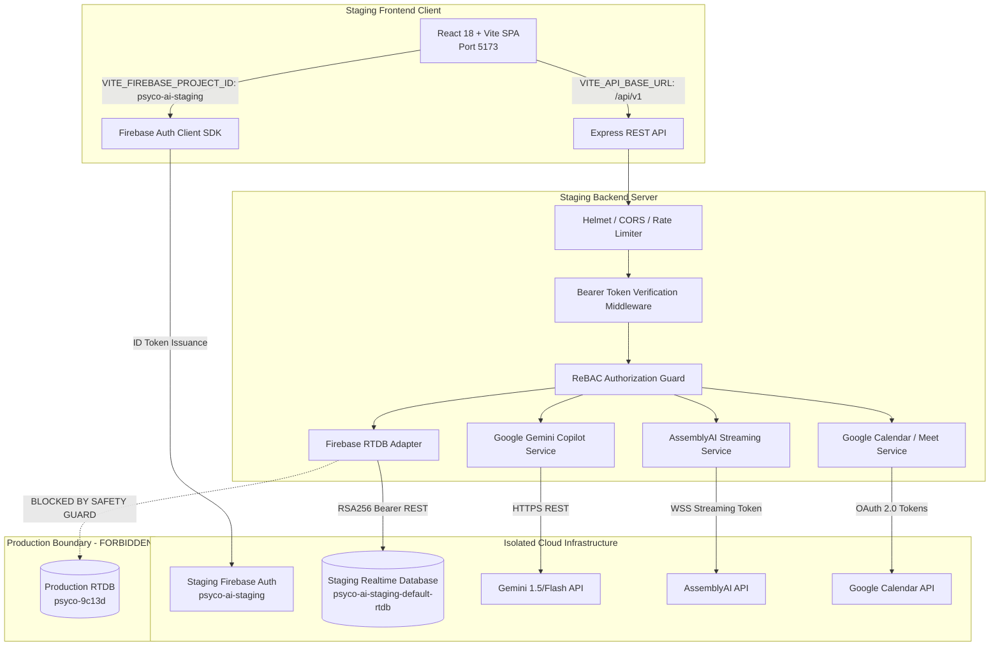

# PSYCO AI — PHASE 1: STAGING ARCHITECTURE SPECIFICATION

**Environment:** Staging (Quality Assurance & User Acceptance Testing)  
**Firebase Project ID:** `psyco-ai-staging`  
**Database URL:** `https://psyco-ai-staging-default-rtdb.firebaseio.com/`  
**Region:** `us-central1`  
**Isolation Status:** COMPLETE (Genuinely isolated infrastructure)

---

## 1. Architectural Overview & Boundaries

The Psyco AI staging environment is constructed as a separate, isolated deployment replicating production architecture without sharing data, credentials, or cloud resources.

---

## 2. Infrastructure Isolation Matrix

| Dimension | Production Environment | Staging Environment | Isolation Guarantee |
| :--- | :--- | :--- | :--- |
| **GCP Project ID** | `psyco-9c13d` | `psyco-ai-staging` | Distinct GCP Project Numbers & IAM Boundaries |
| **Project Number** | `143160785926` | `651213878079` | Zero cross-project token validity |
| **Realtime Database** | `https://psyco-9c13d-default-rtdb.firebaseio.com` | `https://psyco-ai-staging-default-rtdb.firebaseio.com` | Physically distinct database hosts |
| **Database Rules** | Production ruleset | Staging deployed ruleset (27 nodes) | Identical security posture; zero data bleed |
| **Service Account** | `*@psyco-9c13d.iam.gserviceaccount.com` | `firebase-adminsdk-fbsvc@psyco-ai-staging.iam.gserviceaccount.com` | Dedicated staging private key; no production IAM rights |
| **Web App ID** | `1:143160785926:web:...` | `1:651213878079:web:09848e67fa97d2dfbfd98a` | Distinct OAuth app registrations |
| **Clinical Patient Records** | Production records | 100% Synthetic fixtures (`patient_staging_01`) | Zero real patient PHI in staging |

---

## 3. Data Persistence Policy & Invariants

Psyco AI enforces strict data persistence invariants across all environments:

1. **Mandatory Firebase Realtime Database**:
   - The platform strictly uses Firebase Realtime Database.
   - Cloud Firestore is prohibited.
   - SQL or NoSQL database migration is prohibited.

2. **Strict Text-Only Structured JSON Invariant**:
   - All permanent clinical records, appointments, notes, plans, assessment scores, and audit events are stored as structured JSON.
   - **Forbidden Storage**:
     - Raw audio files (.wav, .mp3, .m4a).
     - Video recordings or meeting clips.
     - Image attachments or photos.
     - Base64-encoded binary blobs.
     - Archived PDF exports.
   - Enforced programmatically in `backend/src/integrations/firebase/firebaseRtdbAdapter.js` via `assertValidPayload()`:
     - Rejects any payload containing `data:image/`, `data:audio/`, or `data:video/`.
     - Rejects payloads exceeding 5 megabytes.

3. **Ambient Audio Transient Ingestion**:
   - Audio captured during therapy sessions is streamed over secure WebSockets directly to AssemblyAI using short-lived ephemeral tokens.
   - Audio is never written to disk, database, or cloud object buckets.
   - Only the resulting textual transcript and word timestamps are saved to Realtime Database.

---

## 4. Role-Based Access Control (ReBAC) Architecture

The platform supports three principal roles:

1. **Patient (`role: patient`)**:
   - Scope: Personal demographics, assigned psychologist appointments, assigned clinical assessments, completed self-report results.
   - Boundaries: Strictly prohibited from reading or modifying another patient's data, psychologist clinical notes, or practice administrative logs.

2. **Psychologist (`role: psychologist`)**:
   - Scope: Practice availability, session scheduling, appointment records, SOAP clinical drafts, patient treatment plans, and risk-review flags for assigned patients.
   - Boundaries: Must have an active, confirmed therapeutic assignment with a patient to view their clinical chart. Strictly prohibited from accessing unassigned patients or other clinicians' private records.

3. **Administrator (`role: admin`)**:
   - Scope: Clinician approval/rejection, user account status, practice operational analytics, public contact/FAQ submissions, platform audit trails.
   - **Clinical Privacy Barrier**: Administrators are cryptographically and logically locked out from accessing direct clinical session notes, therapy transcripts, and treatment plans. This barrier is enforced in Express route guards and database security rules.

---

## 5. Network & Communication Boundaries

- **Frontend -> Backend**:
  - Transport: HTTPS / REST via Express router.
  - Authentication: HTTP Bearer authorization header with Firebase JWT.
- **Backend -> Firebase RTDB**:
  - Transport: HTTPS REST with Google OAuth2 service account bearer token minted on demand via RSA256 assertion.
  - Fail-Closed Policy: If remote RTDB write fails or returns HTTP error, operation throws an exception and halts. Silent local-only fallbacks are disabled in authenticated staging mode.
- **Backend -> Third Parties**:
  - Gemini Clinical Copilot: HTTPS POST to `https://generativelanguage.googleapis.com`.
  - AssemblyAI Ambient Transcription: Ephemeral streaming token creation via HTTPS POST to `https://api.assemblyai.com/v2/realtime/token`.
  - Google Calendar & Meet: OAuth 2.0 authorization code flow via `https://accounts.google.com/o/oauth2/v2/auth`.
